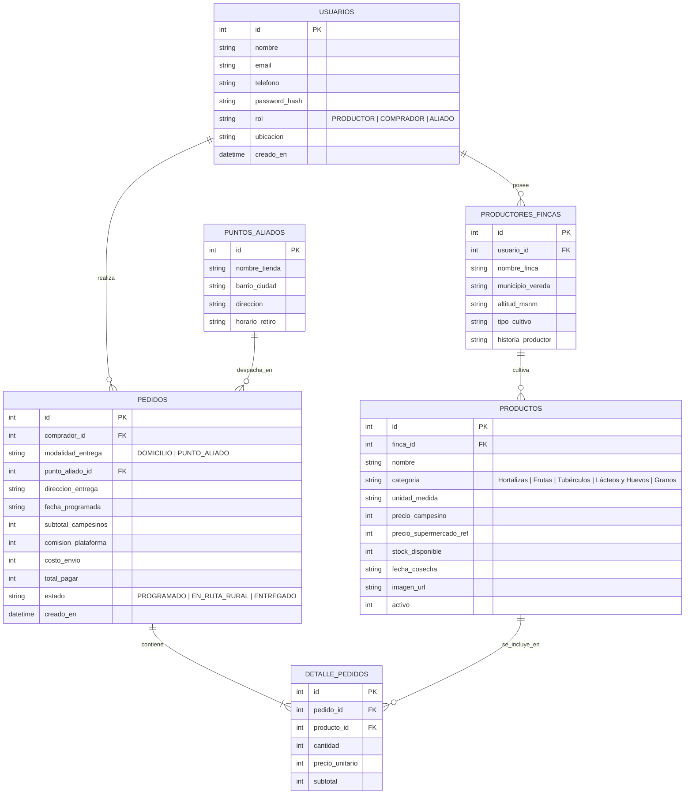

# 🌾 DelCampoApp — Plataforma Web de Comercio Justo y Rutas Programadas


---

## 📋 Información Institucional del Proyecto

- **Institución:** Servicio Nacional de Aprendizaje (SENA) — Centro Nacional de Asistencia Técnica a la Industria (ASTIN)
- **Programa de Formación:** Tecnólogo en Programación de Aplicaciones y Servicios para la Nube
- **Ficha de Caracterización:** 3186266
- **Entregable Técnico:** Bitácora 4 — Prototipo Funcional de la Plataforma Web
- **Aprendiz:** Paulo Andrés De los Reyes González
- **Año:** 2026

---

## 🎯 Descripción del Proyecto

**DelCampoApp** es una plataforma web orientada a servicios que conecta de forma directa a pequeños y medianos productores agrícolas del Valle del Cauca (campesinos de zonas como **Tenerife en El Cerrito, Felidia en los Farallones de Cali, y Bruselas en Dagua**) con consumidores urbanos, tiendas de barrio y restaurantes locales en Cali y su área metropolitana, eliminando intermediarios abusivos y garantizando un precio justo al agricultor.

### 🌟 Pilares Diferenciales del Prototipo

1. **Panel Campesino de Baja Carga Cognitiva:**  
   Interfaz simplificada diseñada especialmente para agricultores con botones táctiles grandes, selección fotográfica rápida, lenguaje cotidiano y control de stock en un solo clic (+10 / -5).
2. **Catálogo Digital con Trazabilidad de Origen:**  
   Cada producto exhibe el nombre del campesino, finca, vereda, altitud (msnm), fecha de cosecha, método agrícola (agroecológico / tradicional limpio) y sello de **0% Intermediarios**.
3. **Módulo de Pedidos Programados y Transparencia Económica:**  
   Los compradores programan sus entregas en rutas semanales consolidadas (Miércoles y Sábados) eligiendo entre **Retiro en Tienda de Barrio Aliada ($0 COP)** o **Domicilio Urbano Agrupado ($4.500 COP)**, visualizando el desglose transparente de cuánto dinero va directo a las manos del campesino (**93%**) y la comisión operativa de la plataforma (**7%**).
4. **Selector Rápido de Rol en Vivo (Modo Demostración SENA):**  
   Permite alternar instantáneamente entre las 4 perspectivas del sistema sin recargar la página:
   - 🛒 *Catálogo y Trazabilidad (Comprador Urbano)*
   - 🛍️ *Canasta de Pedido Programado (Comprador)*
   - 🧑‍🌾 *Panel Campesino (Productor Agrícola)*
   - 🚚 *Hoja de Ruta Logística y Monitor de Base de Datos (Evaluador SENA)*

---

## 🎓 Competencias del Programa SENA ASTIN Aplicadas

| Competencia del Programa | Evidencia Aplicada en DelCampoApp |
| :--- | :--- |
| **1. Administrar base de datos de acuerdo con los estándares y requisitos técnicos** | Modelo relacional en 3FN con integridad referencial (`schema.sql`), triggers y claves foráneas en SQLite3 embebido (`database/delcampoapp.db`). Poblado con datos realistas del Valle del Cauca (`seed.sql`). |
| **2. Desarrollar componentes software de acuerdo con el diseño técnico y requisitos funcionales** | Backend RESTful modular en Node.js y Express (`server.js`) con manejo de transacciones atómicas (ACID) para la creación de órdenes y descuento de inventario. |
| **3. Desplegar servicios y componentes en la nube de acuerdo con la arquitectura y políticas** | Arquitectura autocontenida de costo $0 con motor SQLite embebido dentro del repositorio físico, lista para su ejecución local o despliegue en contenedores / PaaS. |
| **4. Gestionar la calidad en el desarrollo de software de acuerdo con estándares y buenas prácticas** | Frontend responsivo SPA con HTML5 semántico, TailwindCSS, retroalimentación táctil con toasts, validación de inventario y monitoreo técnico en vivo vía `/api/health`. |

---

## 🏛️ Arquitectura del Sistema

```text
DelcampoApp/
├── package.json              # Manifiesto de dependencias y scripts npm
├── server.js                 # Servidor Express, middlewares y API RESTful
├── README.md                 # Documentación técnica completa
├── database/
│   ├── db.js                 # Conector y adaptador SQLite3 (node:sqlite / better-sqlite3)
│   ├── schema.sql            # Definición del modelo relacional (DDL)
│   ├── seed.sql              # Datos semilla de campesinos y productos del Valle (DML)
│   ├── init_db.js            # Script de inicialización y verificación
│   └── delcampoapp.db        # Archivo físico de base de datos embebida (generado)
└── public/                   # Frontend SPA servido por Express
    ├── index.html            # Interfaz de usuario con Selector de Roles SENA
    ├── css/
    │   └── styles.css        # Estilos personalizados agroecológicos y modales
    └── js/
        └── app.js            # Lógica cliente modular (Fetch API, carrito, panel)
```

---

## 🗄️ Diagrama Entidad-Relación (Mermaid)



---

## 🚀 Guía de Instalación y Ejecución Local

Sigue estos 3 sencillos comandos para levantar la aplicación en cualquier sistema con Node.js instalado:

### 1. Instalar dependencias
```bash
npm install
```

### 2. Inicializar y poblar la Base de Datos SQLite embebida
```bash
npm run init-db
```
*(Crea automáticamente el archivo físico `database/delcampoapp.db` con las 6 tablas relacionales y los datos semilla del Valle del Cauca).*

### 3. Iniciar el servidor backend y la aplicación web
```bash
npm start
```

Abre en tu navegador web:
👉 **[http://localhost:3000](http://localhost:3000)**

---

## 📡 Especificación de la API RESTful (`/api`)

| Método | Endpoint | Descripción | Parámetros / Cuerpo |
| :---: | :--- | :--- | :--- |
| `GET` | `/api/health` | Estado del servidor, motor SQLite activo y conteo de tablas en vivo | Ninguno |
| `GET` | `/api/stats` | Resumen de ventas, cosechas activas y ahorro total generado | Ninguno |
| `GET` | `/api/productos` | Catálogo de cosechas con JOIN de trazabilidad campesina completa | `?categoria=`, `?q=` |
| `POST` | `/api/productos` | Publica una nueva cosecha en el panel campesino | JSON con datos del producto y finca |
| `PATCH` | `/api/productos/:id/stock` | Ajuste rápido de inventario o precio por el campesino | `{ "stock_disponible": 50 }` |
| `GET` | `/api/fincas` | Lista de productores y fincas registradas para trazabilidad | Ninguno |
| `GET` | `/api/puntos-aliados` | Lista de tiendas de barrio aliadas para retiro a $0 COP | Ninguno |
| `GET` | `/api/pedidos` | Lista de órdenes programadas con desglose de ítems y transparencia | `?estado=` |
| `POST` | `/api/pedidos` | **Transacción atómica SQL:** Crea pedido, descuenta stock y genera recibo | JSON con comprador, modalidad e ítems |
| `PATCH` | `/api/pedidos/:id/estado` | Avanza el estado del pedido en la hoja de ruta (`PROGRAMADO` → `EN_RUTA_RURAL` → `ENTREGADO`) | `{ "estado": "EN_RUTA_RURAL" }` |

---

## 🌾 Datos Semilla Incluidos (Valle del Cauca)

- **Finca La Esperanza** (Don José Albeiro Rengifo · Vereda Tenerife, El Cerrito): 2.100 msnm. Tomate chonto, Cebolla junca, Papa amarilla criolla.
- **Finca El Rocío** (Doña María del Carmen Valencia · Felidia, Cali): 1.850 msnm. Aguacate papelillo, Lulo de monte, Lechuga crespa, Huevos criollos de pastoreo.
- **Granja Comunitaria Asocampo** (Asociación Asocampo Dagua · Vereda Bruselas, Dagua): 1.400 msnm. Piña oro miel, Plátano hartón, Queso campesino fresco.
- **Puntos Aliados en Cali:** Minimercado La 14 de Alameda, Tienda Doña Martha (San Fernando), Fruver y Abarrotes El Vecino (Valle del Lili).

---

## 👨‍💻 Autor

**Paulo Andrés De los Reyes González**  
Aprendiz SENA — Centro ASTIN  
Tecnólogo en Programación de Aplicaciones y Servicios para la Nube — Ficha 3186266  
*Cali, Valle del Cauca, Colombia — 2026*
