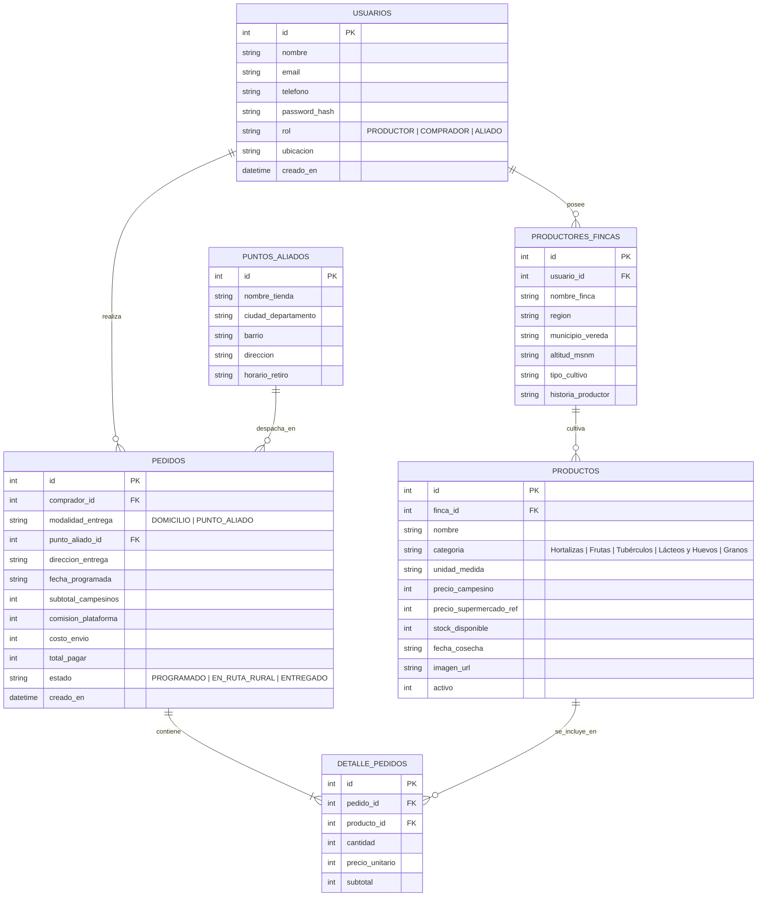

# 🌾 DelCampoApp — AgTech de Comercio Justo y Rutas Programadas


> *"Del campo colombiano directo a tu mesa y negocio"*

**DelCampoApp** es una plataforma web y tecnológica (AgTech) orientada a servicios que conecta directamente a pequeños y medianos productores agrícolas de Colombia (**Región Caribe / Atlántico, Cundinamarca / Sabana y Antioquia / Eje Cafetero**) con consumidores urbanos, tiendas de barrio y restaurantes locales en las principales ciudades del país.

Elimina intermediarios especulativos en la cadena de suministro agroalimentario y consolida rutas semanales de distribución agrupada, garantizando un precio justo y digno para el agricultor y ahorros significativos para el comprador.

---

## 🌟 Pilares y Características Clave

1. **Trato Directo y Transparencia Económica Real:**  
   Cada pedido muestra con total claridad el desglose de costos: el **93%** del subtotal de alimentos ingresa directamente a las manos del productor campesino, con solo un **7%** destinado a la operación tecnológica y logística de la plataforma.
2. **Trazabilidad de Origen Garantizada:**  
   Cada cosecha exhibe el perfil del agricultor, finca, municipio (ej. *Baranoa - Atlántico, Subachoque - Cundinamarca, Marinilla - Antioquia*), altitud sobre el nivel del mar, tipo de cultivo (tradicional limpio, agroecológico u orgánico) y fecha exacta de recolección.
3. **Red Nacional de Tiendas Aliadas ($0 COP Envío):**  
   Los compradores pueden elegir entre entrega a domicilio o retiro sin costo de envío en una red de tiendas de barrio y minimercados urbanos aliados en Barranquilla, Soledad, Bogotá y Medellín.
4. **Portal del Productor de Alta Usabilidad:**  
   Interfaz diseñada para facilitar la publicación rápida de cosechas disponibles, ajuste de inventario en tiempo real (+10 / -5 stock) y visualización de ingresos acumulados.
5. **Centro de Operaciones y Rutas en Vivo:**  
   Gestión logística centralizada para coordinar los despachos semanales (Miércoles y Sábados), con avance de estados (`PROGRAMADO` → `EN_RUTA_RURAL` → `ENTREGADO`) y monitor de infraestructura de base de datos.

---

## 🏛️ Arquitectura del Sistema

```text
DelcampoApp/
├── package.json              # Configuración de dependencias y scripts de arranque
├── server.js                 # Servidor backend Express con API RESTful y transacciones ACID
├── README.md                 # Documentación técnica y de producto
├── database/
│   ├── db.js                 # Adaptador de base de datos SQLite3 embebida (journal DELETE)
│   ├── schema.sql            # Esquema relacional DDL (6 tablas, claves foráneas e índices)
│   ├── seed.sql              # Cosechas y productores reales de Colombia (DML)
│   ├── init_db.js            # Script de inicialización y verificación (`npm run init-db`)
│   └── delcampoapp.db        # Archivo físico de base de datos embebida
└── public/                   # Aplicación cliente SPA
    ├── index.html            # Interfaz moderna de producto AgTech
    ├── css/
    │   └── styles.css        # Estilos agroecológicos, modales y botones táctiles
    └── js/
        └── app.js            # Lógica cliente modular (Fetch API, carrito, panel)
```

---

## 🗄️ Modelo de Datos Relacional



---

## 🚀 Instalación y Puesta en Marcha

### Prerrequisitos
- **Node.js** v20 o superior instalado en el sistema.

### 1. Clonar el repositorio e instalar dependencias
```bash
git clone https://github.com/paulodelosrey/DelcampoApp.git
cd DelcampoApp
npm install
```

### 2. Inicializar la base de datos embebida
```bash
npm run init-db
```
*Aplica el esquema relacional (`schema.sql`) y carga las cosechas y productores de Atlántico, Cundinamarca y Antioquia (`seed.sql`).*

### 3. Iniciar la aplicación
```bash
npm start
```
Abre en tu navegador web preferido:  
👉 **[http://localhost:3000](http://localhost:3000)**

---

## 📡 Especificación de la API RESTful (`/api`)

| Método | Ruta | Descripción | Parámetros / Cuerpo |
| :---: | :--- | :--- | :--- |
| `GET` | `/api/health` | Estado del servicio, motor de base de datos y conteo de tablas | Ninguno |
| `GET` | `/api/stats` | Métricas de ventas, productores activos y ahorro total generado | Ninguno |
| `GET` | `/api/productos` | Catálogo con JOIN de trazabilidad de origen y filtros | `?categoria=`, `?region=`, `?q=` |
| `POST` | `/api/productos` | Publica una cosecha disponible desde el Portal del Productor | JSON de cosecha y finca |
| `PATCH` | `/api/productos/:id/stock` | Ajuste rápido de stock o precio de una cosecha | `{ "stock_disponible": 40 }` |
| `GET` | `/api/fincas` | Lista de productores y fincas registradas | Ninguno |
| `GET` | `/api/puntos-aliados` | Red de tiendas de barrio aliadas para retiro | Ninguno |
| `GET` | `/api/pedidos` | Despachos y pedidos semanales programados | `?estado=` |
| `POST` | `/api/pedidos` | **Transacción ACID:** Crea orden, descuenta inventario y desglosa costos | JSON con comprador, modalidad e ítems |
| `PATCH` | `/api/pedidos/:id/estado` | Actualiza el estado de la orden (`PROGRAMADO` → `EN_RUTA_RURAL` → `ENTREGADO`) | `{ "estado": "EN_RUTA_RURAL" }` |

---

## 🌾 Cobertura de Productores Incluidos

- **Región Caribe / Atlántico:** *Don Rafael Mendoza* — Finca "Villa Rosa" (Baranoa / Polonuevo, Atlántico). Cosechas: Yuca criolla, Ñame espino sabanero, Plátano hartón maduro, Limón Tahití y Queso costeño fresco.
- **Sabana y Centro:** *Doña María del Carmen Vargas* — Finca "El Rocío" (Subachoque, Cundinamarca). Cosechas: Papa pastusa seleccionada, Cebolla junca de rama, Fresas de altura y Huevos campesinos de pastoreo.
- **Antioquia y Eje Cafetero:** *Asociación Agropecuaria Tierra Viva* (El Santuario / Marinilla, Antioquia). Cosechas: Aguacate Hass extra, Tomate chonto rojo, Lechuga hidropónica y Fríjol cargamanto fresco.

---

## 👨‍💻 Autor / Créditos

Desarrollado por **Paulo Andrés De los Reyes González**  
*Colombia — 2026*
